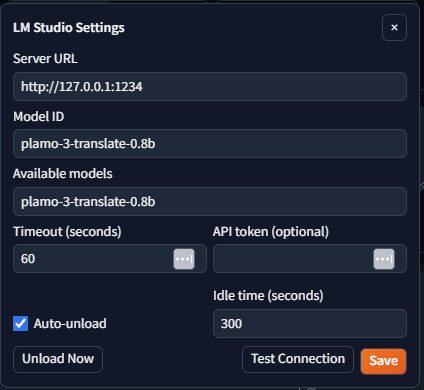
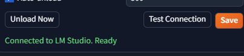

[日本語](#日本語)

# PLaMo Translator for Forge-Neo

Translate prompts between Japanese and English in [Stable Diffusion WebUI Forge - Neo](https://github.com/Haoming02/sd-webui-forge-classic/tree/neo) or reForge. The panel sits below the Positive prompt in txt2img and img2img. [LM Studio](https://lmstudio.ai/) runs PLaMo 3 Translate locally.


## Install the Forge-Neo extension

1. In Forge-Neo or reForge, open **Extensions → Install from URL**.
2. Enter the URL below and select **Install**.
3. Restart the WebUI and refresh the browser. Open **PLaMo Translator** below the Positive prompt.

```text
https://github.com/ukr8b3g-cmyk/Forge-Neo-PLaMo-Prompt-Translator.git
```

For a manual install, download the source ZIP from [Release v0.9](https://github.com/ukr8b3g-cmyk/Forge-Neo-PLaMo-Prompt-Translator/releases/tag/v0.9). Extract its top-level folder into the Forge-Neo `extensions` directory, then restart Forge-Neo. The extension folder should directly contain `scripts/`, `javascript/`, `plamo_backend.py`, and `style.css`.

For reForge, install using the URL above or download the [main branch source ZIP](https://github.com/ukr8b3g-cmyk/Forge-Neo-PLaMo-Prompt-Translator/archive/refs/heads/main.zip) for a manual install. The v0.9 release ZIP is for Forge-Neo.

## Install LM Studio and download PLaMo

1. Open the [official LM Studio download page](https://lmstudio.ai/download), download the LM Studio installer for your OS, and run it. On Windows, choose **Download LM Studio for Windows**.
2. Open **Discover** in LM Studio and search for `pfnet/plamo-3-translate-0.8b-GGUF`. Select the result from **pfnet**, then download `plamo-3-translate-0.8b-Q4_K_M.gguf` under **Download Options**. It is about 0.57 GB. [Official PLaMo model card](https://huggingface.co/pfnet/plamo-3-translate-0.8b-GGUF) · [LM Studio model download guide](https://lmstudio.ai/docs/app/basics/download-model)
3. In LM Studio, open **Model Server** (called **Developer** in some versions) and turn on the server switch. Confirm it shows **Status: Running**. Run the server on the same computer as Forge-Neo. The extension defaults to `http://127.0.0.1:1234`. [LM Studio local server guide](https://lmstudio.ai/docs/developer/core/server)

   

4. In Forge-Neo, click the translator's gear icon. Enter the server URL and model ID, then click **Test Connection**. If the model ID differs, select the PLaMo model from **Available models** and test again. When **Connected to LM Studio. Ready** appears, click **Save**. Enter an API token only if you enabled authentication in LM Studio.


| Settings in Forge-Neo | Default |
| --- | --- |
| Server URL | `http://127.0.0.1:1234` |
| Model ID | `plamo-3-translate-0.8b` |
| Timeout | 60 seconds |
| Auto-unload | Off, with an idle time of 300 seconds when enabled |

<p>
  
  
</p>

## Translate and send

- Click the direction button to switch between Japanese → English and English → Japanese. Enter text or use **Import Positive** to copy the current Positive prompt into the source. Keep LoRA references and prompt-weight syntax in Positive and translate the plain-text portion.
- Click **Translate**. If the selected model is unloaded, the extension asks LM Studio to load it. **Test Connection** can also load the selected model and verify that it is ready.
- Edit the translation or use **Copy**. Choose **Add** to append it to Positive or **Rep** to replace Positive, then click **Send**. **Undo** restores the previous prompt when it has not been edited since Send.
- Enable **Auto-unload** to free the translation model after the selected idle time. **Unload Now** releases the selected model immediately. The next translation loads it again.

Verified on Windows with Forge Neo (Gradio 4.40.0), reForge (Gradio 3.41.2, Python 3.10), and LM Studio 0.4.28. LM Studio and the PLaMo model are obtained separately.

## 日本語

[PLaMo 3 Translate](https://huggingface.co/pfnet/plamo-3-translate-0.8b-GGUF) と [LM Studio](https://lmstudio.ai/) を使って、Forge-Neo・reForge のプロンプトを日本語 ⇄ 英語に翻訳する拡張です。txt2img・img2img の Positive 直下に翻訳パネルが追加されます。翻訳はローカルで行います。


### Forge-Neo に拡張をインストール

1. Forge-Neo または reForge で **Extensions → Install from URL** を開きます。
2. 下の URL を入力して **Install** を押します。
3. WebUI を再起動し、ブラウザーを再読み込みします。Positive の下に **PLaMo Translator** が表示されます。

```text
https://github.com/ukr8b3g-cmyk/Forge-Neo-PLaMo-Prompt-Translator.git
```

手動で導入する場合は、[v0.9 Release](https://github.com/ukr8b3g-cmyk/Forge-Neo-PLaMo-Prompt-Translator/releases/tag/v0.9) のソース ZIP を展開し、展開したフォルダーを Forge-Neo の `extensions` に入れて再起動します。拡張フォルダーの直下に `scripts/`、`javascript/`、`plamo_backend.py`、`style.css` がある状態にします。

reForge では、上の URL からインストールするか、[main ブランチのソース ZIP](https://github.com/ukr8b3g-cmyk/Forge-Neo-PLaMo-Prompt-Translator/archive/refs/heads/main.zip) を使って手動で導入してください。v0.9 のリリース ZIP は Forge-Neo 用です。

### LM Studio のインストールとモデルのダウンロード

1. [LM Studio 公式ダウンロードページ](https://lmstudio.ai/download) から、お使いの OS 用の LM Studio インストーラーをダウンロードして実行します。Windows では **Download LM Studio for Windows** を選びます。
2. LM Studio の **Discover** を開き、`pfnet/plamo-3-translate-0.8b-GGUF` を検索します。配布元が **pfnet** のモデルを選び、**Download Options** から `plamo-3-translate-0.8b-Q4_K_M.gguf`（約0.57 GB）をダウンロードします。 [公式モデル](https://huggingface.co/pfnet/plamo-3-translate-0.8b-GGUF) · [LM Studio 公式のモデル取得手順](https://lmstudio.ai/docs/app/basics/download-model)
3. LM Studio の **Model Server**（バージョンによっては **Developer**）を開き、サーバーのスイッチをオンにします。**Status: Running** と表示されたことを確認してください。Forge-Neo と同じ PC で起動します。拡張の接続先の初期値は `http://127.0.0.1:1234` です。 [ローカルサーバーの公式手順](https://lmstudio.ai/docs/developer/core/server)

   

4. Forge-Neo の翻訳パネルの歯車を押し、接続先とモデル ID を入力して **Test Connection** を押します。ID が異なる場合は **Available models** から PLaMo を選び、もう一度接続確認します。**Connected to LM Studio. Ready** が緑で表示されたら **Save** を押します。LM Studio で認証を有効にした場合は API トークンも入力します。


| Forge-Neo 側の設定 | 初期値 |
| --- | --- |
| 接続先 URL | `http://127.0.0.1:1234` |
| モデル ID | `plamo-3-translate-0.8b` |
| タイムアウト | 60秒 |
| 自動アンロード | オフ。有効時の初期待ち時間は300秒 |

<p>
  
  
</p>

### 翻訳とプロンプトへの反映

- 方向ボタンを押すたびに日英・英日が切り替わります。原文を入力するか、**Import Positive** で現在の Positive を取り込みます。LoRA 参照や重み構文は Positive に残し、翻訳したい文章を原文欄に入れてください。
- **Translate** を押すと翻訳します。選択したモデルが未ロードなら LM Studio が自動で読み込みます。**Test Connection** からもモデルをロードして **Ready** を確認できます。
- 訳文は編集・**Copy** ができます。**Add** は追記、**Rep** は置換です。反映方法を選び **Send** を押します。反映後の Positive が編集されていなければ **Undo** で戻せます。
- **Auto-unload** をオンにすると、翻訳に使ったモデルが指定時間後に解放されます。**Unload Now** で即時解放でき、次の翻訳時に再ロードされます。

Windows の Forge Neo（Gradio 4.40.0）、reForge（Gradio 3.41.2、Python 3.10）、LM Studio 0.4.28 で確認済みです。LM Studio 本体と PLaMo モデルは別途入手してください。日本語ロケールでは日本語、英語または未設定のロケールでは英語で表示します。

