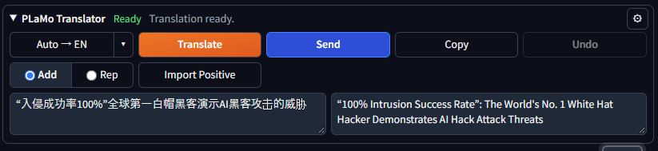
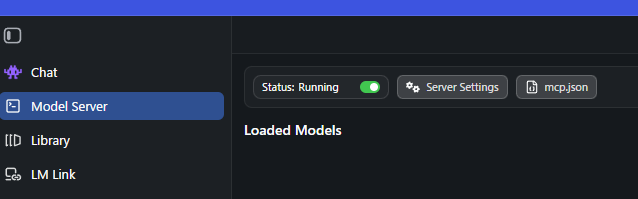
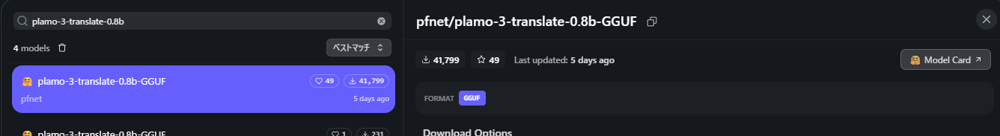
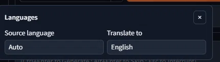
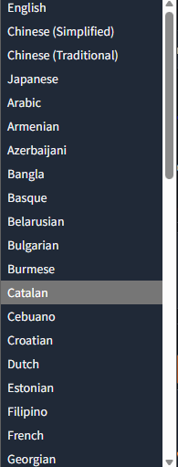

[日本語](#日本語)

# PLaMo Translator for Forge-Neo — v1.1

Translate prompts among 53 languages in [Stable Diffusion WebUI Forge - Neo](https://github.com/Haoming02/sd-webui-forge-classic/tree/neo) or reForge. The panel sits below the Positive prompt in txt2img and img2img. [LM Studio](https://lmstudio.ai/) runs PLaMo 3 Translate locally.

**v1.1 adds 53-language selection and automatic long-text translation.** Keep the source on **Auto**, choose the output language, and click **Translate** once.



## Install the Forge-Neo extension

1. In Forge-Neo or reForge, open **Extensions → Install from URL**.
2. Enter the URL below and select **Install**.
3. Restart the WebUI and refresh the browser. Open **PLaMo Translator** below the Positive prompt.

```text
https://github.com/ukr8b3g-cmyk/Forge-Neo-PLaMo-Prompt-Translator.git
```

For a manual install, download **Source code (zip)** from [Release v1.1](https://github.com/ukr8b3g-cmyk/Forge-Neo-PLaMo-Prompt-Translator/releases/tag/v1.1). Extract its top-level folder into the Forge-Neo or reForge `extensions` directory, then restart the WebUI. The extension folder should directly contain `scripts/`, `javascript/`, `languages.json`, `plamo_backend.py`, and `style.css`.

To update, use **Extensions → Installed → Check for updates → Apply and restart UI**, then reload the browser. For a manual update, replace the existing extension's files; avoid keeping a second copy alongside it. The original [v0.9 release](https://github.com/ukr8b3g-cmyk/Forge-Neo-PLaMo-Prompt-Translator/releases/tag/v0.9) remains available separately.

## Install LM Studio and download PLaMo

1. Open the [official LM Studio download page](https://lmstudio.ai/download), download the LM Studio installer for your OS, and run it. On Windows, choose **Download LM Studio for Windows**.
2. Open **Discover** in LM Studio and search for `pfnet/plamo-3-translate-0.8b-GGUF`. Select the result from **pfnet**, then download `plamo-3-translate-0.8b-Q4_K_M.gguf` under **Download Options**. It is about 0.57 GB. [Official PLaMo model card](https://huggingface.co/pfnet/plamo-3-translate-0.8b-GGUF) · [LM Studio model download guide](https://lmstudio.ai/docs/app/basics/download-model)
3. In LM Studio, open **Model Server** (called **Developer** in some versions) and turn on the server switch. Confirm it shows **Status: Running**. Run the server on the same computer as Forge-Neo. The extension defaults to `http://127.0.0.1:1234`. [LM Studio local server guide](https://lmstudio.ai/docs/developer/core/server)

   

4. In Forge-Neo, click the translator's gear icon. Enter the server URL and model ID, then click **Test Connection**. If the model ID differs, select the PLaMo model from **Available models** and test again. When **Connected to LM Studio. Ready** appears, click **Save**. Enter an API token only if you enabled authentication in LM Studio.



| Settings in Forge-Neo | Default |
| --- | --- |
| Server URL | `http://127.0.0.1:1234` |
| Model ID | `plamo-3-translate-0.8b` |
| Total timeout | 60 seconds |
| Maximum output tokens | 512 per request |
| Auto-unload | Off, with an idle time of 300 seconds when enabled |

<p>
  
</p>

## Translate and send

- Open **▾** beside the direction button to select **Source language** and **Translate to**. Normally leave **Source language** on **Auto**. If the source is not recognized correctly, select its language manually.
- **Translate to** is the destination language. For image prompts, start with **English**, or choose **Chinese** when that suits the image model you use. You can also translate into Japanese or any of PLaMo's other supported languages. The output language is always selected explicitly.
- Enter text or use **Import Positive** to copy the current Positive prompt into the source. Natural-language text can contain ordinary parentheses and brackets, such as `(adult)` and `[front view]`. Add explicit controls such as `<lora:portrait:0.8>` and `(red coat:1.2)` directly in Positive.
- Click **Translate**. If the selected model is unloaded, the extension asks LM Studio to load it. **Test Connection** can also load the selected model and verify that it is ready.
- Edit the translation or use **Copy**. Choose **Add** to append it to Positive or **Rep** to replace Positive, then click **Send**. Send preserves the text in the translation field, including ordinary punctuation. Forge interprets that text using its prompt settings when generating. **Undo** restores the previous prompt when it has not been edited since Send.
- Enable **Auto-unload** to free the translation model after the selected idle time. **Unload Now** releases the selected model immediately. The next translation loads it again.



The menu lists **English → Chinese (Simplified) → Chinese (Traditional) → Japanese**, then the other languages. The compact direction button shows language codes; the menu and tooltip show full names. Click the direction button to swap two explicitly selected languages, or open the menu when the source is Auto. Each tab remembers its language selection in the same browser and origin.

### Supported languages

There are **53 language choices**, including separate Simplified and Traditional Chinese options. **Auto** is an additional source-only choice. The screenshot below shows the **Translate to** menu; scroll to see the remaining languages.



<details>
<summary>All 53 languages and codes</summary>

| Language | Language | Language |
| --- | --- | --- |
| English `en` | Chinese (Simplified) `zh-hans` | Chinese (Traditional) `zh-hant` |
| Japanese `ja` | Korean `ko` | Arabic `ar` |
| Azerbaijani `az` | Belarusian `be` | Bulgarian `bg` |
| Bengali `bn` | Catalan `ca` | Cebuano `ceb` |
| German `de` | Spanish `es` | Estonian `et` |
| Basque `eu` | Persian `fa` | French `fr` |
| Gujarati `gu` | Hebrew `he` | Hindi `hi` |
| Croatian `hr` | Hungarian `hu` | Armenian `hy` |
| Indonesian `id` | Italian `it` | Javanese `jv` |
| Georgian `ka` | Kazakh `kk` | Khmer `km` |
| Lithuanian `lt` | Latvian `lv` | Malayalam `ml` |
| Marathi `mr` | Malay `ms` | Burmese `my` |
| Nepali `ne` | Dutch `nl` | Punjabi `pa` |
| Polish `pl` | Russian `ru` | Sinhala `si` |
| Slovak `sk` | Slovenian `sl` | Serbian `sr` |
| Swahili `sw` | Tamil `ta` | Telugu `te` |
| Thai `th` | Tagalog `tl` | Urdu `ur` |
| Uzbek `uz` | Vietnamese `vi` |  |

</details>

### Long text and output tokens

Click **Translate** once. Long input is split into pieces of up to 2,000 source characters, preferring paragraphs, then lines, sentences, or words. The pieces are translated in order and joined. A piece that reaches the output-token or context limit is split further and retried. Splitting can affect context and terminology between paragraphs, so review the result.

In **gear → Maximum output tokens**, choose 256, 512, 1024, or 2048; the default is 512. This is the limit for each request, not the combined translation. Characters and tokens are different units. The combined result may exceed 2,048 tokens. **Total timeout (seconds)** covers model preparation and all pieces. Source limits are 16,000 characters / 64 KiB UTF-8; combined-output limits are 64,000 characters / 256 KiB UTF-8.

An unresolved cutoff is marked as partial and cannot be sent to Positive. Increase **gear → Maximum output tokens** and translate again. For a timeout, adjust **gear → Total timeout**. Cancel discards the result; the in-flight backend operation must finish before another translation can start. Auto-unload counts idle time after the entire operation ends, including failure.

The [PFN language list](https://huggingface.co/pfnet/plamo-3-translate-0.8b-GGUF#supported-languages) defines the 53 choices, counting Simplified and Traditional Chinese separately. The extension's codes are in [languages.json](languages.json).

The v1.1 update was tested with Forge Neo (Gradio 4.40.0) and real LM Studio on Windows: six translation directions, a 14,098-character source producing 2,605 completion tokens across eight requests, Send/Undo, and Compact layout restoration. Python tests passed in Neo and reForge environments. reForge's live integration was verified before this update; its v1.1 live UI has not been retested. [Validation](docs/VALIDATION.md) · [Changes](CHANGELOG.md). LM Studio and the PLaMo model are obtained separately.

## 日本語

[PLaMo 3 Translate](https://huggingface.co/pfnet/plamo-3-translate-0.8b-GGUF) と [LM Studio](https://lmstudio.ai/) を使って、Forge-Neo・reForge のプロンプトを53言語間で翻訳する拡張です。txt2img・img2img の Positive 直下に翻訳パネルが追加されます。翻訳はローカルで行います。

**v1.1で53言語の選択と長文の自動分割に対応しました。** 原文は **Auto（自動）** を基本に、翻訳先を選んで **Translate** を1回押すだけです。


### Forge-Neo に拡張をインストール

1. Forge-Neo または reForge で **Extensions → Install from URL** を開きます。
2. 下の URL を入力して **Install** を押します。
3. WebUI を再起動し、ブラウザーを再読み込みします。Positive の下に **PLaMo Translator** が表示されます。

```text
https://github.com/ukr8b3g-cmyk/Forge-Neo-PLaMo-Prompt-Translator.git
```

手動で導入する場合は、[v1.1 Release](https://github.com/ukr8b3g-cmyk/Forge-Neo-PLaMo-Prompt-Translator/releases/tag/v1.1) の **Source code (zip)** を展開し、展開したフォルダーを Forge-Neo または reForge の `extensions` に入れて再起動します。拡張フォルダーの直下に `scripts/`、`javascript/`、`languages.json`、`plamo_backend.py`、`style.css` がある状態にします。

更新は **Extensions → Installed → Check for updates → Apply and restart UI** から行い、ブラウザーも再読み込みします。手動更新の場合は既存の拡張フォルダー内を入れ替え、同じ拡張を二重に入れないようにしてください。従来の [v0.9 Release](https://github.com/ukr8b3g-cmyk/Forge-Neo-PLaMo-Prompt-Translator/releases/tag/v0.9) もそのまま残しています。

### LM Studio のインストールとモデルのダウンロード

1. [LM Studio 公式ダウンロードページ](https://lmstudio.ai/download) から、お使いの OS 用の LM Studio インストーラーをダウンロードして実行します。Windows では **Download LM Studio for Windows** を選びます。
2. LM Studio の **Discover** を開き、`pfnet/plamo-3-translate-0.8b-GGUF` を検索します。配布元が **pfnet** のモデルを選び、**Download Options** から `plamo-3-translate-0.8b-Q4_K_M.gguf`（約0.57 GB）をダウンロードします。 [公式モデル](https://huggingface.co/pfnet/plamo-3-translate-0.8b-GGUF) · [LM Studio 公式のモデル取得手順](https://lmstudio.ai/docs/app/basics/download-model)
3. LM Studio の **Model Server**（バージョンによっては **Developer**）を開き、サーバーのスイッチをオンにします。**Status: Running** と表示されたことを確認してください。Forge-Neo と同じ PC で起動します。拡張の接続先の初期値は `http://127.0.0.1:1234` です。 [ローカルサーバーの公式手順](https://lmstudio.ai/docs/developer/core/server)

   

4. Forge-Neo の翻訳パネルの歯車を押し、接続先とモデル ID を入力して **Test Connection** を押します。ID が異なる場合は **Available models** から PLaMo を選び、もう一度接続確認します。**Connected to LM Studio. Ready** が緑で表示されたら **Save** を押します。LM Studio で認証を有効にした場合は API トークンも入力します。


| Forge-Neo 側の設定 | 初期値 |
| --- | --- |
| 接続先 URL | `http://127.0.0.1:1234` |
| モデル ID | `plamo-3-translate-0.8b` |
| 全体タイムアウト | 60秒 |
| 最大出力トークン数／1回 | 512 |
| 自動アンロード | オフ。有効時の初期待ち時間は300秒 |

<p>
  
</p>

### 翻訳とプロンプトへの反映

- 方向ボタン横の **▾** で言語を選びます。左の **Source language（原文の言語）** は、通常 **Auto（自動）** のままで使えます。原文の言語をうまく認識できない場合だけ、手動で選んでください。
- 右の **Translate to（翻訳先）** は、出力したい言語です。画像生成プロンプトでは、まず **英語** を基本に、使う画像モデルに合わせて **中国語** などを選びます。日本語への確認用の翻訳や、PLaMoが対応するほかの言語への翻訳にも使えます。翻訳先は自動ではなく、必ず指定します。
- 原文を入力するか、**Import Positive** で現在の Positive を取り込みます。通常の括弧を含む文章（`(adult)`、`[front view]`など）も翻訳できます。`<lora:portrait:0.8>`や`(red coat:1.2)`など、明示的なプロンプト制御構文は Positive に直接入力してください。
- **Translate** を押すと翻訳します。選択したモデルが未ロードなら LM Studio が自動で読み込みます。**Test Connection** からもモデルをロードして **Ready** を確認できます。
- 訳文は編集・**Copy** ができます。**Add** は追記、**Rep** は置換です。**Send** は訳文欄の括弧などをそのまま Positive に渡します。生成時の解釈は Forge のプロンプト設定に従います。反映後の Positive が編集されていなければ **Undo** で戻せます。
- **Auto-unload** をオンにすると、翻訳に使ったモデルが指定時間後に解放されます。**Unload Now** で即時解放でき、次の翻訳時に再ロードされます。


選択肢は **英語 → 中国語（簡体字）→ 中国語（繁体字）→ 日本語 → その他** の順です。通常のボタンには短い言語コードを表示し、メニューとツールチップには言語名を表示します。原文・翻訳先を指定した場合は方向ボタンで入れ替わり、原文が自動の場合は言語メニューが開きます。同じブラウザー・接続先では、タブごとに選択を記憶します。

### 対応言語

中国語の簡体字・繁体字を別々に数えて **53言語** です。原文側だけに **Auto（自動）** が加わります。下の画像は右側の **Translate to（翻訳先）** の一覧です。スクロールすると続きの言語が表示されます。


<details>
<summary>53言語とコードをすべて表示</summary>

| 言語 | 言語 | 言語 |
| --- | --- | --- |
| 英語 `en` | 中国語（簡体字） `zh-hans` | 中国語（繁体字） `zh-hant` |
| 日本語 `ja` | 韓国語 `ko` | アラビア語 `ar` |
| アゼルバイジャン語 `az` | ベラルーシ語 `be` | ブルガリア語 `bg` |
| ベンガル語 `bn` | カタルーニャ語 `ca` | セブアノ語 `ceb` |
| ドイツ語 `de` | スペイン語 `es` | エストニア語 `et` |
| バスク語 `eu` | ペルシャ語 `fa` | フランス語 `fr` |
| グジャラート語 `gu` | ヘブライ語 `he` | ヒンディー語 `hi` |
| クロアチア語 `hr` | ハンガリー語 `hu` | アルメニア語 `hy` |
| インドネシア語 `id` | イタリア語 `it` | ジャワ語 `jv` |
| ジョージア語 `ka` | カザフ語 `kk` | クメール語 `km` |
| リトアニア語 `lt` | ラトビア語 `lv` | マラヤーラム語 `ml` |
| マラーティー語 `mr` | マレー語 `ms` | ビルマ語 `my` |
| ネパール語 `ne` | オランダ語 `nl` | パンジャーブ語 `pa` |
| ポーランド語 `pl` | ロシア語 `ru` | シンハラ語 `si` |
| スロバキア語 `sk` | スロベニア語 `sl` | セルビア語 `sr` |
| スワヒリ語 `sw` | タミル語 `ta` | テルグ語 `te` |
| タイ語 `th` | タガログ語 `tl` | ウルドゥー語 `ur` |
| ウズベク語 `uz` | ベトナム語 `vi` |  |

</details>

### 長文とトークン上限

**Translateは1回押すだけ**です。原文を最大2,000文字ずつ、段落の切れ目を優先して分割します。段落だけで収まらない場合は改行・文・単語の切れ目を使い、順番に翻訳してひとつに結合します。出力トークンやコンテキストの上限に達した区間は、さらに分割して再翻訳します。区間をまたぐ文脈や用語が揃わない場合があるため、訳文は確認してください。

**歯車 → 最大出力トークン数／1回** は256・512・1024・2048から選べ、初期値は512です。分割した各区間の上限なので、結合後の訳文は2,048トークンを超えられます。文字数とトークン数は別の単位です。**全体タイムアウト（秒）** はモデル準備と全区間を含む時間です。原文は最大16,000文字・UTF-8で64 KiB、結合後の訳文は最大64,000文字・256 KiBです。

再分割しても途中で切れた場合は部分訳として表示し、Sendを無効にします。**歯車 → 最大出力トークン数** を増やして再翻訳してください。時間切れの場合は **歯車 → 全体タイムアウト** を調整します。中止は結果の受け取りを止め、通信処理が終了してから次の翻訳ができます。自動アンロードの待ち時間は、失敗した場合も含めて処理全体の終了後から数えます。

対応言語は[PFN公式の53言語](https://huggingface.co/pfnet/plamo-3-translate-0.8b-GGUF#supported-languages)です。中国語は簡体字・繁体字を別々に選べます。実装の言語コード一覧は [languages.json](languages.json) にあります。

v1.1はWindowsのForge Neo（Gradio 4.40.0）と実LM Studioで、多言語6方向、14,098文字から8リクエスト・計2,605出力トークンへの長文翻訳、Send・Undo、Compactでの配置復帰を確認しました。Neo・reForge両方のPython環境でテストも通過しています。reForgeの実画面は以前の版で確認済みですが、v1.1の実画面は未検証です。[検証範囲](docs/VALIDATION.md) · [変更履歴](CHANGELOG.md)。LM Studio本体とPLaMoモデルは別途入手してください。画面はForgeの日本語ロケールでは日本語、それ以外では英語で表示します。


## Live translation (current main)

Click **Live OFF** beside Translate to enable automatic translation. **Live ON** is red; its tooltip explains the action. Translation starts 800 ms after typing stops, after IME composition completes. Only the newest input is translated next; stale replies do not overwrite edits. Click again to turn it off. Errors are not retried continuously. Send remains manual; Live never changes Positive or starts image generation. The switch is remembered per tab in this browser. Reloading alone does not start translation.


## 自動翻訳（最新main）

Translateの隣の **Live OFF／自動翻訳 OFF** を押すと自動翻訳がオンになります。オンは赤色で、マウスを重ねると説明が表示されます。入力停止から800ミリ秒後、日本語IMEの変換確定後に翻訳します。待機するのは最新の原文だけで、古い応答で手編集を上書きしません。もう一度押すとオフになり、エラー時に再試行を繰り返すこともありません。Positiveへの反映は引き続きSendで行います。ブラウザー内でtxt2img／img2imgごとにオン・オフを記憶し、再読み込みだけでは翻訳しません。
